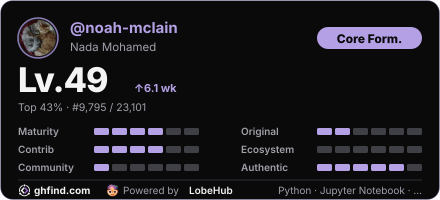

# hey, i'm Nada 👋

Based in Cairo · CS graduate with Honors · Open to AI/ML roles

## a little about me

I turn research into practical software, mostly agents and LLM systems. I like building things that go beyond a notebook and become something people can use.

I built **Payramid**, an award-winning blockchain payroll platform, and interned at **SAIB Bank** and **Dell Technologies**. These days, my work spans intelligent agents, fine-tuning LLMs, and shipping the systems around them.

## things i've been building

- [**Jarvis**](https://github.com/noah-mclain/Jarvis-AI-Assistant) · An AI assistant.
- [**OverClocked**](https://github.com/noah-mclain/OverClocked) · Hardware and software performance monitoring.
- [**My portfolio**](https://github.com/noah-mclain/portfolio-site) · Projects, experience, and a bit more about me.

## around GitHub

Ghfind snapshot · 1 November 2026 · [View current profile](https://ghfind.com/en/u/noah-mclain)
