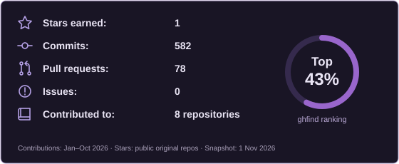

  

Computer Science graduate and AI/ML engineer based in Cairo. I build intelligent agents, fine-tune LLMs, and turn research into practical software. My work spans AI, full-stack development, and blockchain, including Payramid, an award-winning payroll platform.

  
  

find more at [nadaa.dev](https://nadaa.dev/)
